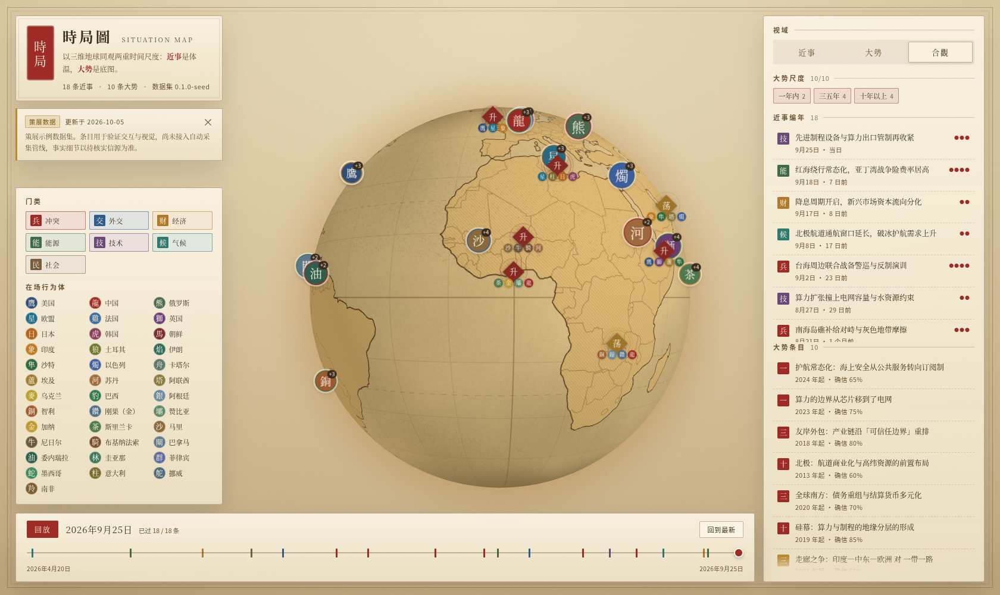

# 時局圖 · Situation Map

一个复古版画风格的三维地球观察站：**同一个球面上，同时安放"短期发生的事"与"长期成形的势"**。



---

## 它解决什么问题

绝大多数地缘信息产品要么是新闻流（只有近事，看完就散），要么是智库长文（只有大势，读起来悬空）。
这两者的关系其实是体温与体温计的关系：

- **近事**（`SituationEvent`）——某日、某地、可定位、有起讫两端。是"体温"：变化快、噪声大、单条不可外推。
- **大势**（`Trend`）——跨年度、无确切日期、有方向和置信度、沿一条走廊展开。是"底图"：变化慢、决定哪些事件是可能的。

这个应用把两者放在同一个地球上、用同一套词汇（行为体 + 地点）表达，于是可以互相印证：
看到"红海绕行"这条近事时，能立刻看到它压在"护航常态化"和"供应链重排"两条大势的哪一段上。

---

## 快速开始

```bash
npm install

npm run dev        # http://127.0.0.1:5180
npm run build      # tsc --noEmit && vite build
npm run preview    # 预览构建产物 http://127.0.0.1:5181
npm run pipeline   # 数据集体检报告
```

环境里有几个已知的坑，脚本已经绕开：

- 若 `npm install` 报 `EROFS`，说明 npm 缓存目录不在可写区，加 `--cache ./.npm-cache`。
- 无头环境下要看渲染效果，用 `scripts/screenshot.mjs`（见"视觉验收"）。

### 关于 `base`

构建默认走 `base: '/'`，所以 `build && preview` 本地就能直接跑通。
GitHub Pages 的项目页需要 `/situation-map/` 前缀，由 workflow 注入 `VITE_BASE` 环境变量完成：

```bash
VITE_BASE=/situation-map/ npm run build
```

**不要把这个前缀写死进 `vite.config.ts`** ——`vite preview` 不会按 `base` 挂载 `dist`，
写死之后本地预览会拿到 index.html 的 404 回退，表现为"白屏但控制台只有一句资源 404"。

---

## 用法

| 操作 | 效果 |
| --- | --- |
| 拖动 / 滚轮 | 旋转与缩放地球；一开始会缓慢自转，一旦交互就停 |
| 点击印章 / 罗盘 / 右侧条目 | 打开详情，镜头自动飞到现场 |
| `Esc` | 关闭详情 |
| 空格 | 开始 / 暂停时间回放 |
| 「近事 / 大勢 / 合觀」 | 切换图层组合 |
| 门类色块 | 过滤近事门类（全关会自动复位） |
| 时间游标 | 语义是"截至某日已知的情形"：游标右侧的事件**不出现**，越过游标的事件留在图上 |

---

## 项目结构

```
src/
  types.ts                 两条时间尺度的数据模型（这是全项目的宪法）
  theme.ts                 调色板、门类元信息、inkify()
  data/
    actors.json            37 个行为体：一个字徽记 + 印色 + 一句注释
    events.json            18 条近事
    trends.json            10 条大势
    meta.json              数据集版本与免责声明
    load.ts                装载 + 校验（浏览器端的入库闸门）
  globe/
    parchment.ts           程序化生成羊皮纸版画地球贴图（无外部图片）
    markers.ts             印章 / 罗盘标记的 DOM 构造
  components/
    GlobeStage.tsx         globe.gl 生命周期与图层装配
    ControlRail.tsx        视域切换、筛选、条目列表
    Timeline.tsx           时间游标与回放
    DetailPanel.tsx        详情面板
    Legend.tsx  Header.tsx  DataNotice.tsx
  styles/globals.css       全部样式（羊皮纸 + 墨线 + 朱砂）
scripts/
  pipeline.mjs             数据入库闸门：校验 / 补坐标 / 体检 / 写入
  screenshot.mjs           无头浏览器视觉验收
data/
  gazetteer.json           67 条地名→经纬度，给只有地名的新条目补坐标
  raw/                     候选数据投放目录（管线预留）
docs/
  ARCHITECTURE.md          设计取舍与 Phase 2 管线蓝图
  shots/                   视觉验收截图
```

---

## 数据契约

两条时间尺度是这套东西的全部要害，所以字段刻意不对称：

**近事**（`src/data/events.json`）必须有 `date`、`category`、`severity`、至少一个 `places`；
`confidence` 只有三档，且 `verified` 必须附至少一条带 `url` 的信源——**声称已核实却拿不出链接，会在入库时直接报错。**

```jsonc
{
  "id": "evt-taiwan-strait-patrol",
  "title": "台海周边联合战备警巡与反制演训",
  "date": "2026-09-02",
  "category": "conflict",            // conflict|diplomacy|economy|energy|tech|climate|society
  "actors": ["chn", "usa", "jpn"],   // 引用 actors.json
  "places": [
    { "name": "台湾海峡", "lat": 24.5, "lon": 119.5, "role": "site" }
  ],
  "summary": "……",
  "severity": 4,                     // 1..5，决定印章大小、涟漪半径与排序
  "emblem": "一句话隐喻",             // 可选，详情页引用块
  "confidence": "illustrative",
  "sources": [{ "label": "区域军事活动通报（待接入）", "url": "可选" }],
  "tags": ["第一岛链", "半导体"]
}
```

**大势**（`src/data/trends.json`）没有 `date`，取而代之的是 `since` + `horizon` + `direction` + `confidence`，
以及一条至少两个节点的 `corridor`（走廊折线）。`counterforce`（反向张力）强烈建议填写——
写不出对立面的趋势条目，多半是叙事而不是判断。

```jsonc
{
  "id": "trend-silicon-curtain",
  "title": "硅幕：算力与制程的地缘分层的形成",
  "since": "2019",
  "horizon": "10y",                  // 1y|3y|10y
  "direction": "rising",             // rising|falling|stable|volatile
  "confidence": 0.85,                // 0..1
  "actors": ["usa", "chn", "jpn", "eu", "kor"],
  "corridor": [{ "name": "华盛顿", "lat": 38.9, "lon": -77.04, "role": "origin" }, ...],
  "drivers": ["……"],
  "indicators": [{ "label": "管制清单条目数", "value": "逐年增加", "change": "上行" }],
  "summary": "……",
  "counterforce": "……"
}
```

### 新增一条数据的流程

```bash
# 1. 把候选条目写进 data/raw/events.candidate.json（只需名字，坐标可以留给地名册补）
# 2. 校验
node scripts/pipeline.mjs --check data/raw/events.candidate.json --kind events
# 3. 通过后写入 src/data/，自动备份原文件并 bump 版本号
node scripts/pipeline.mjs --promote data/raw/events.candidate.json --kind events
# 4. 体检
node scripts/pipeline.mjs --report
```

`src/data/load.ts` 里有一份同规则的校验，浏览器端会再查一遍。**两处规则要同步改。**

---

## 部署

推 `main` 即触发 `.github/workflows/deploy.yml`：先跑数据体检（有错误就让构建失败，坏数据不上线），
再 `npm run build`，发布到 GitHub Pages。

项目页在 `https://<user>.github.io/<repo>/` 下，所以 `vite.config.ts` 把 `base` 交给 `VITE_BASE` 环境变量，
workflow 里用仓库名注入。本地开发仍是 `/`。

---

## 视觉验收

WebGL 在无头环境要靠 SwiftShader 软件渲染，必须显式打开 `--enable-unsafe-swiftshader`，否则白屏而控制台只有一句
`Error creating WebGL context`。脚本已经配好：

```bash
npm i -D playwright && npx playwright install chromium
npm run dev &
PLAYWRIGHT_BROWSERS_PATH=./.browsers node scripts/screenshot.mjs
# 产出 docs/shots/*.png，并打印控制台错误与 DOM 计数
```

Playwright 故意没有写进 `package.json`：这是个静态站，不该为了几张截图让 CI 去下载整个 Chromium。

---

## 现状与下一步

**已完成（Phase 1）**：三维地球 + 两层时间尺度 + 时间回放 + 详情面板 + 筛选 + 入库闸门 + Pages 部署。

**尚未完成（Phase 2）**：数据集目前是**人工策展的示例数据**（`meta.json` 里 `curated: true`，
每条 `confidence: "illustrative"`），事实细节以待核实信源为准。接自动采集管线的设计见
[docs/ARCHITECTURE.md](docs/ARCHITECTURE.md#phase-2自动管线该怎么做)。
